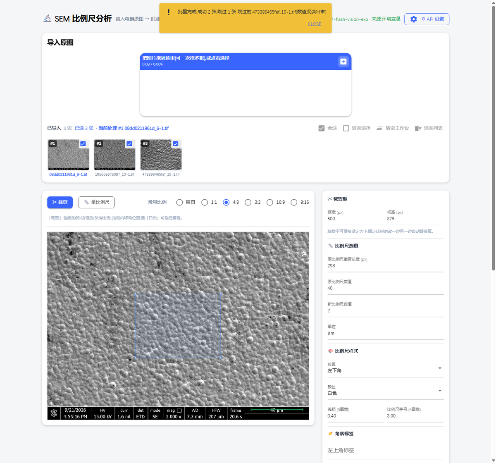
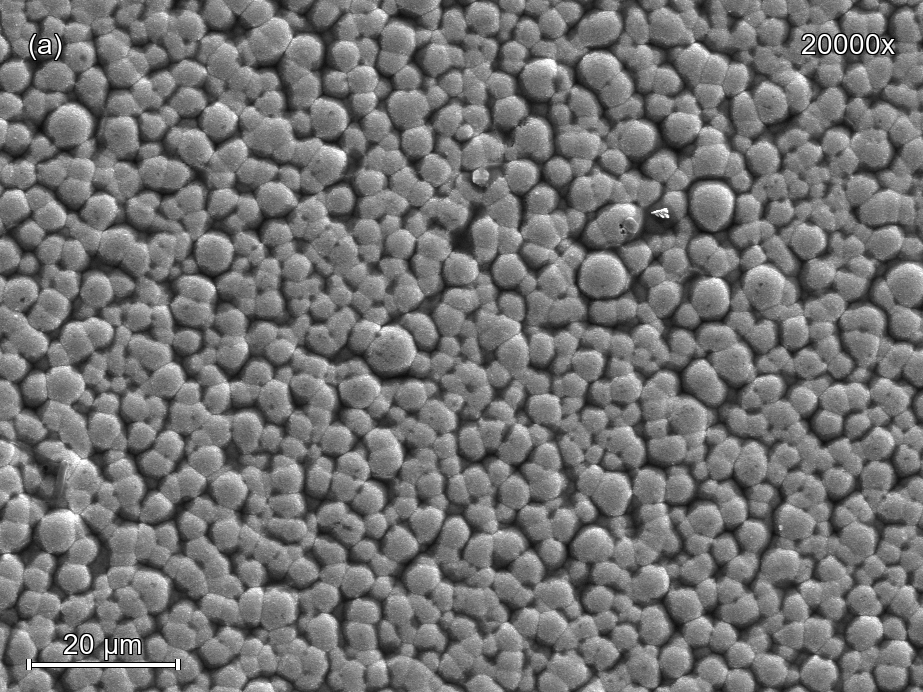

# AutoSEM Processor

**自动 SEM 图像处理工具** —— 把电镜原图批量变成能直接进 PPT / 论文的成图：拖入图片 → 自动识别比例尺 → 框选裁剪 → 生成带比例尺和角标的成图 → 批量处理 → 拼成整合图下载。

单页应用，**不依赖数据库，不需要装 Tesseract**，Windows / Linux / macOS 都能跑。



<sub>▲ 工作台：一次拖入多张原图 → 自动识别比例尺 → 框选裁剪 → 批量出图 → 拼整合图下载</sub>



<sub>▲ 产出：裁剪后重绘比例尺（数字居中在横线上方、带反色描边保证任何底色上都能看清），角标可按模板自动递增</sub>

---

## Quick Start (English)

```bash
# 1. install (creates .venv and installs deps)
install.bat              # Windows: double-click it, or run in cmd
bash install.sh          # Linux / macOS

# 2. run
run.bat                  # Windows
bash run.sh              # Linux / macOS

# 3. open http://127.0.0.1:8090  and drag your SEM images in
```

Manual equivalent:

```bash
python -m venv .venv
.venv/Scripts/python -m pip install -r requirements.txt   # Windows
.venv/bin/python     -m pip install -r requirements.txt   # Linux / macOS
.venv/Scripts/python app.py                               # then open the URL above
```

Requirements: **Python 3.10+**. No API key needed to start — see [配置 AI](#配置-ai读比例尺数值可选) to enable automatic reading of the scale-bar value.

---

## 它做什么

| 步骤 | 说明 |
|---|---|
| 1. 导入 | 一次拖入多张原图（PNG / JPG / BMP / **8位或16位 TIF**），左侧出现预览条 |
| 2. 识别比例尺 | 自动在底部元数据栏里找到比例尺横线，给出**像素长度**；配了 API 还会自动读出「40 μm」这样的数值 |
| 3. 裁剪 | 拖框的角/边缩放（保持 4:3 等固定比例）、拖框内移动；也可以直接填像素宽高 |
| 4. 生成 | 填新比例尺数值 → 在裁剪图上画好比例尺（数字 + 横线 + 刻度 + 描边）和左上/右上角标 |
| 5. 批量 | 勾选若干张 → 每张各自识别比例尺、套同一个构图，角标自动递增（`(a) (b) (c)` …） |
| 6. 整合图 | 结果区的图按顺序拼成网格图，一键下载 |

结果图全部按**内容哈希**命名存在 `data/sem_out/`，不会互相覆盖；工作台状态会落盘，刷新页面不丢。

---

## 安装

前置：**Python 3.10 或更新**（[python.org](https://www.python.org/downloads/)，Windows 安装时记得勾 *Add python.exe to PATH*）。

```bash
install.bat        # Windows（双击即可）
bash install.sh    # Linux / macOS
```

脚本会建 `.venv`、装依赖、跑一次导入自检。国内网络默认走清华镜像，失败会自动回退官方源。

> Linux 上如果报 `ensurepip is not available`，先 `sudo apt install python3-venv`（Debian/Ubuntu）。

## 启动

```bash
run.bat        # Windows（双击；缺环境会自动先装）
bash run.sh    # Linux / macOS
```

浏览器打开 **http://127.0.0.1:8090**（Windows 下会自动打开）。关掉窗口 = 停止服务。

改端口 / 监听地址：

```bat
set LAB_PORT=9000          :: Linux/macOS 用 export LAB_PORT=9000
set LAB_HOST=0.0.0.0       :: 想让局域网访问时才开（本机存着 API key，默认只听本机）
set LAB_NO_BROWSER=1       :: 启动时不自动开浏览器
```

## 配置 AI（读比例尺数值，可选）

比例尺上的数值（如 `40 μm`）交给**多模态大模型**读。**不配也能用** —— 比例尺的像素长度是本地 OpenCV 算的，只是数值要手填。

三种配法，优先级从高到低：

1. **界面里配（推荐）**：打开页面 → 右上角「⚙ API 设置」→ 选个预设或手填 `base_url` / `api_key` / `model` → 「测试连接」→ 「保存」。**保存即生效，不用重启。** 配置写到项目根目录的 `.env.local`（已在 `.gitignore`，不会进 git）。
2. **环境变量**：`set VISION_API_KEY=...` / `export VISION_API_KEY=...`（适合临时调试或部署）。
3. **`.env` 文件**：把 `.env.example` 复制成 `.env` 再填。

变量名：`VISION_API_KEY` / `VISION_BASE_URL` / `VISION_MODEL`。
旧名 `DEEPSEEK_API_KEY` / `DEEPSEEK_BASE_URL` / `DEEPSEEK_VISION_MODEL` 仍会被识别（作为回退），老配置不用改。

接口是**通用的 OpenAI 格式**（`/chat/completions`），下面这些都行：

| 服务 | base_url | model 示例 |
|---|---|---|
| DeepSeek | `https://api.deepseek.com` | `deepseek-v4-flash-vision-exp` |
| OpenAI | `https://api.openai.com/v1` | `gpt-4o-mini` |
| 通义千问（阿里云） | `https://dashscope.aliyuncs.com/compatible-mode/v1` | `qwen-vl-max` |
| 智谱 GLM | `https://open.bigmodel.cn/api/paas/v4` | `glm-4v` |
| Ollama（本地） | `http://localhost:11434/v1` | `qwen2.5vl` |
| vLLM（本地） | `http://localhost:8000/v1` | 你自己起的模型 |

要点：

- **模型必须是能看图的**（多模态 / VL），纯文本模型读不了。
- `base_url` 填**根地址**（通常要带 `/v1`），程序自己补 `/chat/completions`；直接把整条 endpoint 粘进去也行。
- 本地 ollama / vLLM 一般**不需要 key**，留空即可。
- 出海服务不通时，在「测试连接」里会明确告诉你卡在哪一步（401 是 key 不对、404 多半是 `base_url` 少了 `/v1`、连不上则提示网络或本地服务没起）。

---

## 使用说明

### 导入
把图拖到上方虚线框里（可一次多张），或点击选择。缩略图右上角有勾选框 —— **批量只处理勾上的那些**。点缩略图本身 = 把它加载到下面的处理区。

### 量比例尺
加载一张图后会自动识别，图上出现**绿色横线**标出识别到的位置，右侧「原比例尺像素长度」自动填好；配了 API 还会填上「原比例尺数值」。
认不出来或认错了，就点「📏 量比例尺」，在图上**点左端 → 点右端**，长度自动回填。

### 裁剪
「✂ 裁剪」模式下：拖四角/四边缩放（按「常用比例」保持形状），拖框内移动位置。也可以直接在右侧填「框宽 / 框高」的像素值。选「自由」可以拖任意形状的框。

### 生成 / 批量
填好「新比例尺数值」（比如原图 40 μm 你想标成 2 μm，就填 2）→ 点「生成图片」。
要批量：先在任意一张图上量一次比例尺、把框调好（**倍数会被记住**），填好新数值，再点「批量处理选中」。每张图各自识别比例尺，角标按你填的模板顺序递增（填 `(a)` 就会得到 `(a) (b) (c)…`）。处理不了的会跳过，结束时列出每张的原因。

### 整合图
结果区的图可以**拖动卡片**调整顺序，然后设「每行几张 / 行数」→「组合成整合图」→「下载图片」。
行数填 0 表示按图片数量自动算。尺寸差异特别大的图建议分批组合（网格是按第一张的比例对齐的，其余图会被居中裁切）。

---

## 常见问题

**Q: 必须配 API 吗？**
不用。只有「自动读出比例尺上的数值」需要。像素长度是纯本地算法。

**Q: 端口被占用 / 起不来。**
`set LAB_PORT=9001`（Linux/macOS `export LAB_PORT=9001`）后重跑。

**Q: 提示 `ImportError: libGL.so.1`（Linux）。**
装成了非 headless 版的 opencv。`pip uninstall opencv-python && pip install opencv-python-headless`。

**Q: 数值总是读不出来。**
先点「测试连接」看具体报错。确认用的模型是**多模态**的，且 `base_url` 带对了 `/v1`。模型偶尔读不出某张图是正常的（图上文字不清晰），手填即可。

**Q: 比例尺上的数字变成了方块。**
系统缺字体。装任意一个 DejaVu / Noto / Arial 系字体即可（程序会按 Windows → Linux → macOS → 用户字体目录的顺序找）。

**Q: 16 位 TIF 在预览里是空白？**
预览走的是转码后的 8 位缩略图，原图不受影响，处理链路用的仍是原图。

**Q: 想让同事从别的电脑访问？**
`set LAB_HOST=0.0.0.0` 后重跑，别人访问 `http://你的IP:8090`。⚠️ 本机存着 API key，只在可信网络里这么做。

---

## 项目结构

```
app.py                    入口：建目录 → 应用主题 → 起服务
core/config.py            路径常量（数据都在 data/ 下）
core/settings.py          API 配置的读写、优先级、连通性测试
core/sem.py               图像算法：读图、比例尺检测、画比例尺、拼网格
core/workspace.py         工作台落盘（刷新/重启不丢）
integrations/vision.py    调多模态模型读比例尺数值
views/sem.py              页面：导入、裁剪、生成、批量、整合图
views/settings_dialog.py  「⚙ API 设置」弹窗
views/theme.py            配色与全局样式
data/                     运行期数据（已 gitignore）：sem_src 原图 / sem_out 成图 / sem_grid 整合图
```

改主题看 `views/theme.py`；改算法看 `core/sem.py`（里面记了各种仪器形态的踩坑结论，动之前先读注释）。

---

## License

MIT
